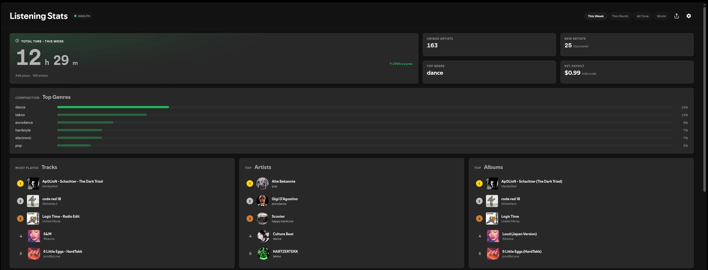
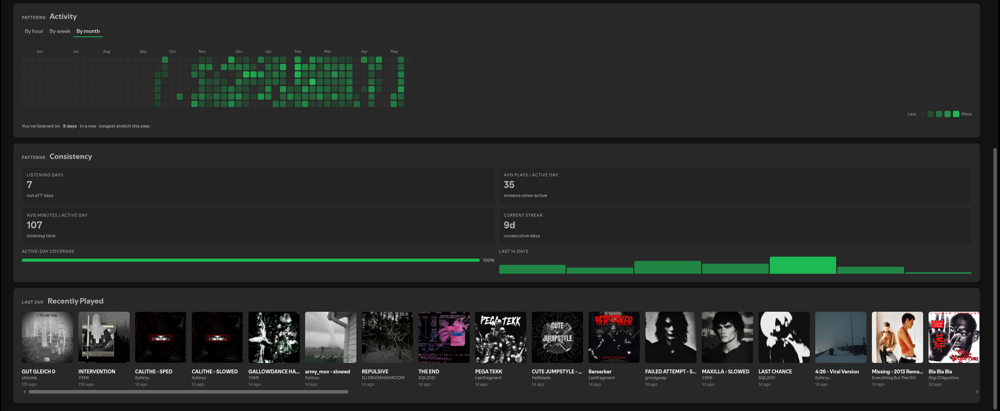

# Listening Stats

Spicetify custom app: a listening statistics dashboard inside Spotify (stats.fm, Last.fm, or local tracking).


[](https://github.com/Xndr2/listening-stats/releases)


  

## Features

- Track plays on this device with no account, or connect stats.fm or Last.fm. Every period works with every source, including last month.
- Each part of the page appears as soon as its own data arrives, and your last view shows instantly while it refreshes.
- Top tracks, artists, albums and genres, ranked by plays or by time, with an 8-week trend per track. Click a genre to see its artists; right-click a row for Spotify's own menu.
- Listening by hour and by weekday, a 26-week heatmap, and your genre mix.
- Auto playlists of your top tracks, as many as you like, each with its own period, size and schedule. They live in your Spotify library, so Listening Stats finds them again after a reinstall or on another computer.
- A play count for the current song in the player bar.
- Share cards of your top tracks or artists, as a story or a wide image.
- World charts of what people on stats.fm are playing.
- Import and export as JSON or CSV, plus import of Spotify's own streaming history. Your v2 history and settings carry over.
- Colours come from your Spicetify theme, light or dark.
- If one part of the page breaks, the rest keeps working, and you can send a report from Settings.

End-user guides and troubleshooting: **[Wiki](https://github.com/Xndr2/listening-stats/wiki)**.

## Requirements

- Spotify desktop client
- If Spicetify is **not** installed yet, the one-liner below installs the **Spicetify CLI** for you (then installs Listening Stats).  
  - **macOS / Linux:** installs to `~/.spicetify` (needs `curl`, `tar`, `grep`; do **not** run the installer with `sudo`).  
  - **Windows:** installs under `%LOCALAPPDATA%\spicetify` (use a **non-admin** PowerShell window).  
- If Spicetify is **already** on your `PATH`, the script skips CLI install and only downloads Listening Stats.

## Installation

**Linux / macOS**

```bash
curl -fsSL https://raw.githubusercontent.com/Xndr2/listening-stats/main/install.sh | bash
```

**Windows (PowerShell)**

```powershell
irm https://raw.githubusercontent.com/Xndr2/listening-stats/main/install.ps1 | iex
```

This does **not** install the Spicetify Marketplace. You can add it later from [Spicetify docs](https://spicetify.app/docs/getting-started) if you want.

**Manual:** grab **`listening-stats.zip`** from [Releases](https://github.com/Xndr2/listening-stats/releases), extract so you have `CustomApps/listening-stats/` containing `manifest.json`, `index.js`, and `extension.js`, then:

```bash
spicetify config custom_apps listening-stats && spicetify apply
```

## Contributing

Feedback and bug reports are welcome. There is an active Discord: **[invite](https://discord.gg/XtqbFAHk6a)**.

1. Fork the repository  
2. Branch: `git checkout -b feature/your-feature`  
3. Run **`pnpm lint`** and a production **`pnpm build`** before opening a PR  
4. Open a pull request against **`main`**

## License

MIT
